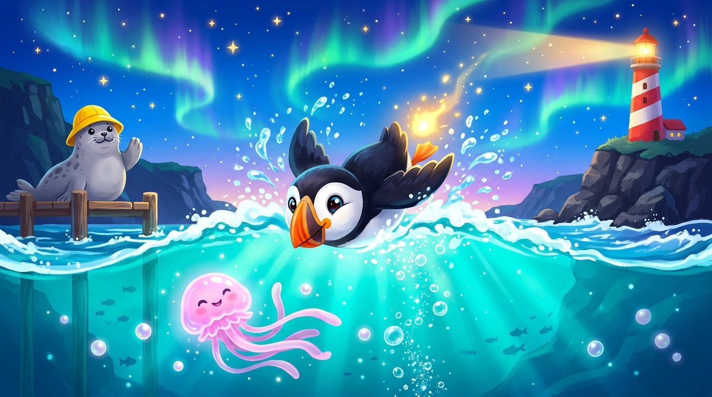

<div align="center">



# 🐧✨ Flap & Plopp: The Fjord Shift 🌊🌌

**Flap through the fjord sky! Plopp beneath the glowing waves! Relight the Northern Lighthouse! 🗼💛**

[](https://godotengine.org/)
[](https://itch.io/jam/game-off-2024)
[](#)
[](#-under-the-hood-the-four-laws--5-stack-kernels)
[](LICENSE)

---

*Sky pulls you **down** 🌤️ · Sea lifts you **up** 🌊 · One tap of **`SHIFT`** flips the whole fjord upside down! 🔄✨*

</div>

---

## 🎮 What Is Flap & Plopp?

Play as **Pip** 🐧 — a chubby, fearless little Norwegian puffin carrying a golden spark ✨ across **four vibrant fjord chapters** to relight the dark **Northern Lighthouse** 🗼!

* 🌤️ **In the Sky (`FLAP!`):** Gravity pulls Pip down — tap `SPACE` to flap past red harbour buoys and snatch twinkling golden stars ⭐!
* 🌊 **In the Sea (`PLOPP!`):** Hit `SHIFT` to plunge underwater! Buoyancy lifts Pip up — tap `SPACE` to dive deep past glowing pink jellyfish 🪼 and scoop up luminous pearls 🫧!
* 🫧 **Golden `HOLD` Bubble (`H`):** Spark getting too hot 🔥? Freeze the entire fjord in a cozy golden `HOLD` bubble (`0.00 V`), catch your breath, and cool down — time alone will **never** pop it until *you* press `SPACE`!
* 🌌 **100% Procedural Magic:** Zero external sprite or audio files — every wave, aurora ribbon, puffin wingbeat, and retro PCM chime is drawn and synthesized live inside **Godot 4.3**!

---

## 🚀 Play in 10 Seconds

```bash
git clone https://github.com/sololys/flap-plopp.git
cd flap-plopp
make play
```

> 🎯 **Requirement:** **Godot 4.3** on your `PATH`. Want to run the full 5-stack verification suite (Godot + Rust + C11 + SystemVerilog RTL + Python)? Run `make verify`! ✅

---

## 🕹️ Controls

| 🎯 Action | ⌨️ Keyboard | 🖱️ Mouse |
| :--- | :--- | :--- |
| 🪽 **Flap up** (Sky) / 🤿 **Dive down** (Sea) / 💬 **Next dialogue** | `Space` / `W` / `Up` / `Enter` | Left Click |
| 🔄 **`SHIFT`!** Flip between Sky (`SPLASH! 💦`) and Sea (`PLOPP! 🫧`) | `Shift` / `S` / `Down` | Right Click |
| 💛 **`HOLD` Bubble** — freeze the fjord & cool your spark safely | `H` | — |
| ⏭️ **Skip Dialogue** / 🔁 **Restart Story** | `Esc` / `R` | — |

### 🌟 Pro Arcade Tips

* 💦 **Skim the Waterline:** Hit `SHIFT` right near the waves to stack a **Combo Multiplier up to `x8` 🔥** and cool your spark meter fast!
* 🟡 **Hit the Golden Ring (Poincaré Return!):** After your first `SHIFT`, a glowing golden target ring marks your departure altitude. Flip back through it on your return to trigger a massive **`POINCARE RETURN!` 🏆** bonus!
* ⭐ **Stars & Pearls Cool Your Spark:** Every flap heats up your spark meter $C(t) < R$. Grab stars ⭐ in the sky and pearls 🫧 under the sea to stay cool and keep flying!
* 🫧 **No Panic — Tap `H`!** Whenever the reef gets intense, pop into `HOLD` to pause everything at `0.00 V` and plan your next flip.

---

## 🐾 Meet the Fjord Crew

| Character | Role | Quote |
| :--- | :--- | :--- |
| 🐧 **Pip** | Heroic little puffin with a golden spark | *"One SHIFT plops me from Sky to Sea, and a second SHIFT splashes me right back home!"* |
| 🦭 **Captain Klabb** | Salty harbour seal in a yellow hat | *"Fish cakes on the pier once the beacon is lit!"* |
| 🪼 **Lumina** | Glowing pink jellyfish of Jellyfish Cove | *"Bloop-hello, Pip! Glowing pearls cool your spark right down!"* |
| 🗼 **Keeper Sol** | Guardian of the Northern Lighthouse | *"The northern lights are out — bring that spark to the lantern!"* |

---

## 🗺️ Four Fjord Chapters + Endless Aurora

| 🏁 Chapter | 🌊 Fjord Zone | 🏆 Goal | 🎨 Atmosphere |
| :--- | :--- | :--- | :--- |
| **🌅 Chapter 1** | **Morning Pier** | `160 pts` | Crisp sunlit blue sky, playful waves, learning the `FLAP!` / `PLOPP!` groove |
| **🌇 Chapter 2** | **Jellyfish Cove** | `420 pts` | Golden amber sunset, faster currents, glowing pearls 🫧 and bobbing jellyfish 🪼 |
| **🌆 Chapter 3** | **Twilight Reef** | `760 pts` | Deep violet dusk, rising spark heat 🔥, tactical golden `HOLD` pauses 💛 |
| **🌌 Chapter 4** | **Northern Lighthouse** | `1150 pts` | Dancing emerald & violet aurora ribbons, the dark lighthouse ahead — **light the beacon!** 🗼✨ |
| **♾️ Bonus Mode** | **Endless Aurora** | `∞ pts` | Unlocked on victory — surf the aurora forever and chase your high score! 🏆 |

---

## ⚙️ Under the Hood: The Four Laws & 5-Stack Kernels

Beneath the cozy puffin arcade runs a rock-solid, zero-float deterministic architecture built around four fail-closed laws (`INSPIRED_BY != IMPLEMENTS != PROVES`):

1. 🔄 **$T(T(s)) = s$ (Sky ↔ Sea Involution):** Flip twice and return with zero residual; land inside the golden $\epsilon$-ring for a **Poincaré Return** bonus.
2. 🔥 **$C(t) < R$ (Spark Ceiling):** Every flap and second raises spark load $C(t)$ toward ceiling $R = 100$. Stars, pearls, clean flips, and `HOLD` keep you cool.
3. 💛 **`HOLD` (Safe Waiting Room, `11.2 Hz` Pulse):** `H` pauses the world at `0.00 V` and cools $C(t)$ gently — elapsed time alone **never** opens `HOLD` without explicit player input.
4. ⚡ **`KILL` (Discrete `0.00 V` Cutoff):** Bonking an obstacle or hitting $C(t) \ge R$ triggers an instant `KILL` cutoff, appends the event to the witness log (never erased on retry), and lets you retry the current chapter cleanly.

<details>
<summary><strong>🔬 Open the 5-Stack Verification Suite (<code>make verify</code>) — Godot 4.3, Rust 🦀, QNX C11 ⚙️, SystemVerilog RTL 🔌 &amp; Python 🐍</strong></summary>

| Layer | Files | Verification |
| :--- | :--- | :--- |
| 🎮 **Godot 4.3 Game Core** | [`scripts/game_core.gd`](scripts/game_core.gd), [`scripts/main.gd`](scripts/main.gd), [`scripts/sound_synth.gd`](scripts/sound_synth.gd), [`scripts/story_data.gd`](scripts/story_data.gd) | `37/37` headless checks in [`tests/test_game_core_headless.gd`](tests/test_game_core_headless.gd) |
| 🦀 **Rust Zero-Float Kernels** | [`rust/ky_engine_v1.rs`](rust/ky_engine_v1.rs), [`rust/millennium_gate_v1.rs`](rust/millennium_gate_v1.rs) | `#![forbid(unsafe_code)]`, exact $\tau \le 27/50$, Doc 171/176/178/181/183/185 invariants |
| ⚙️ **QNX / C11 Zero-Float Gates** | [`c11_qnx/flap_plopp_qnx_gate.c`](c11_qnx/flap_plopp_qnx_gate.c), [`c11_qnx/sluse_3d_gate.c`](c11_qnx/sluse_3d_gate.c), [`c11_qnx/lih_sluse_gate.c`](c11_qnx/lih_sluse_gate.c), [`c11_qnx/ky_kora_sluse.c`](c11_qnx/ky_kora_sluse.c) | `-msoft-float -mno-sse -mno-sse2` + `OBJDUMP_ZERO_FLOAT_OK` on all 4 binaries |
| 🔌 **SystemVerilog RTL** | [`rtl/lih_sluse_gate.sv`](rtl/lih_sluse_gate.sv), [`rtl/ky_kora_sluse.sv`](rtl/ky_kora_sluse.sv) | `iverilog -g2012` + `vvp` (`7/7` LiH + `7/7` KORA latched-`KILL` parity) |
| 🐍 **Python Phase-Mirror v0.1** | [`python/phase_mirror.py`](python/phase_mirror.py) | `6/6` zero-float HPIS scenarios, deterministic SHA-256 ledger & tamper detection |

Aligned with [omega-gate-qnx](https://github.com/sololys/omega-gate-qnx) and Zenodo DOIs [`10.5281/zenodo.23244129`](https://doi.org/10.5281/zenodo.23244129) & [`10.5281/zenodo.23244425`](https://doi.org/10.5281/zenodo.23244425).

</details>

---

<div align="center">

## 📜 License

MIT — see [LICENSE](LICENSE).

*Made with 💛 in Risør, Norway · Flap high, plopp deep, light the beacon! 🐧🌊🗼*

</div>
